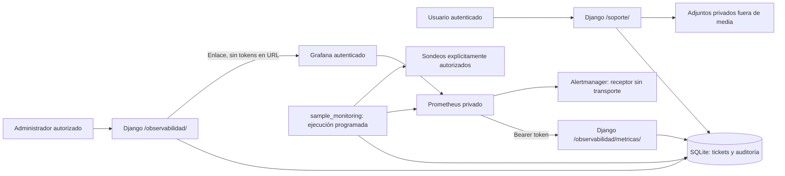

# Mesa de ayuda y Centro de monitoreo

## Arquitectura y alcance

La ampliación conserva Django 5.2, Bootstrap 5.3.0-alpha1, la autenticación y la organización del proyecto. **Desplegada en producción el 8 de noviembre de 2026**, con respaldo previo y autorización explícita del usuario. Se aplicaron las cuatro migraciones y se activaron los servicios nativos documentados en [el informe de despliegue](audits/2026-11-08-production-support-monitoring.md).



Aplicaciones nuevas:

- `support/`: modelos, formularios, permisos, servicios transaccionales, vistas, plantillas, migraciones y pruebas.
- `observability/`: instrumentación HTTP/SQL, señales de autenticación, instantáneas agregadas, alertas persistentes, vistas, comando `sample_monitoring`, migraciones y pruebas.
- `deploy/observability/`: stack de desarrollo Linux, cinco dashboards JSON, aprovisionamiento de Grafana, configuración y pruebas de Prometheus, Alertmanager y hook de Gunicorn.

Se añade una dependencia de ejecución: `prometheus-client==0.25.0`. No se introduce una cadena de compilación TypeScript: las pantallas reutilizan Django, Bootstrap y el JavaScript responsivo existente. Loki y OpenTelemetry se posponen porque ya existen logs organizados y no hay un sistema distribuido instrumentado que justifique desplegarlos ahora.

## Modelos y relaciones

| Modelo | Función |
| --- | --- |
| Category | Catálogo configurable; siete categorías iniciales; se puede desactivar sin romper el historial. |
| SLAPolicy | Un objetivo por prioridad: primera respuesta, resolución y plazo de reapertura. Inicialmente deshabilitados. |
| Ticket | UUID, solicitante, organización capturada al crear, asunto, descripción, categoría, prioridad, estado, responsable, fechas, objetivos SLA y versión de edición. |
| Comment | Comentario público o nota interna, con autor y fecha. |
| Attachment | Archivo privado, nombre original, tamaño, tipo validado, autor y comentario opcional. |
| TicketEvent | Historial por ticket; eventos internos filtrados del lado del servidor. |
| Notification | Avisos internos por usuario, con fecha de lectura. No envía correo ni Telegram. |
| SupportAudit | Auditoría restringida de categorías, SLA, agentes y reglas de monitoreo. |
| UserActivity | Última actividad autenticada muestreada por usuario; no contiene IP, token ni sesión. |
| AlertRule / AlertIncident / AlertEvent | Umbrales configurables, incidentes por regla/servicio y eventos de activación/resolución. |

Tickets, comentarios y auditoría conservan sus autores mediante `PROTECT`; para retirar cuentas con historial se debe desactivar la cuenta, no borrar su identidad histórica.

## Roles y autorización

| Perfil | Alcance |
| --- | --- |
| Usuario autenticado | Crear, consultar y comentar sus tickets; descargar sus adjuntos públicos; leer sus avisos; confirmar resolución y reabrir dentro del plazo. |
| Grupo «Agentes de soporte» | Permiso `support.work_ticket`: atiende tickets asignados dentro de su organización; un agente central sin organización puede recibir tickets de distintas organizaciones. |
| Permiso `support.view_queue` | Autoriza la cola de la organización del usuario; un perfil central sin organización tiene alcance transversal. Para atender necesita también `work_ticket`. |
| Grupo «Administradores de soporte» | `work_ticket`, `view_queue`, `manage_support`; asignación, prioridades y estadísticas dentro del alcance autorizado. Configuración global de categorías/SLA solo si no tiene organización. |
| Administrador global sin organización o superusuario | Administración de soporte y monitoreo, incluida gestión del grupo de agentes. |
| `observability.view_monitoring` | Acceso técnico explícito; solo perfiles sin organización. No concede acceso a conversaciones de soporte ni a configuración de alertas. |
| `observability.configure_monitoring` | Además de acceso técnico, permite editar reglas. |

Los grupos no se asignan automáticamente a usuarios existentes. Ocultar botones no es el control de seguridad: las vistas y servicios comprueban permisos, asignación y organización. Un usuario conserva acceso a sus propias solicitudes históricas aunque cambie de organización; ese acceso no concede permisos internos de agente sobre otra organización.

### Flujo de estados

- Abierto → En revisión, En proceso o Pendiente de información.
- En revisión → En proceso, Pendiente de información o Resuelto.
- En proceso → En revisión, Pendiente de información o Resuelto.
- Pendiente de información → En revisión, En proceso o Resuelto.
- Resuelto → Cerrado o Abierto.
- Cerrado → Abierto.

El solicitante solo confirma un caso resuelto o reabre uno resuelto/cerrado dentro del plazo (7 días por defecto). El equipo autorizado gestiona el resto del flujo. Las notas internas no fijan la primera respuesta ni notifican al solicitante. Una respuesta pública de soporte sí fija la primera respuesta.

Cada edición envía la versión que el usuario vio. La actualización condicional de esa versión evita sobrescribir cambios concurrentes; una edición obsoleta o un bloqueo concurrente de SQLite devuelve HTTP 409 y pide recargar. No se reintentan automáticamente comentarios que podrían duplicarse.

### SLA

Objetivos orientativos, **deshabilitados hasta que el administrador los active**:

| Prioridad | Primera respuesta | Resolución |
| --- | --- | --- |
| Baja | 72 horas | 120 horas |
| Media | 24 horas | 72 horas |
| Alta | 4 horas | 24 horas |
| Crítica | 1 hora | 4 horas |

Son horas corridas, sin calendario laboral ni pausas automáticas por falta de información. Los objetivos se capturan al crear; la prioridad recalcula desde la creación y la reapertura establece un nuevo plazo de resolución desde ese momento. El promedio de resolución mide desde la creación hasta la resolución actual más reciente. Un caso reabierto deja de contarse como resuelto. El cumplimiento de Grafana usa únicamente casos resueltos con objetivo configurado. Estos objetivos iniciales son una propuesta operativa, no un compromiso contractual.

## Archivos privados

`SUPPORT_PRIVATE_ROOT` debe estar fuera de cualquier directorio servido por Nginx, `MEDIA_ROOT`, archivos estáticos o proxy MinIO. Los adjuntos nuevos no usan el backend público de medios existente. Se conservan con nombres UUID, permisos 0600 y directorios 0700. La descarga pasa por `/soporte/adjuntos/<id>/`, valida el ticket y la privacidad del comentario y fuerza `Content-Disposition: attachment`, `nosniff` y caché privada deshabilitada.

Se admiten PNG, JPEG, PDF y TXT UTF-8; se valida tamaño (5 MB por defecto), extensión y firma básica del contenido. Se rechazan SVG, HTML y ejecutables. La validación no equivale a un análisis antivirus. Un fallo transaccional elimina los archivos que alcanzaron a guardarse. El respaldo de esta carpeta debe incorporarse al respaldo de SQLite; no forma parte del volumen MinIO actual.

## Métricas y límites reales

| Área | Implementado | Alcance / límite |
| --- | --- | --- |
| HTTP | RPS, RPM, duración promedio, P50/P95/P99, 4xx/5xx, concurrencia, endpoints utilizados/lentos y solicitudes sobre el umbral. | Histograma hasta cabeceras de respuesta; no mide descarga completa ni detecta por sí solo workers terminados por timeout. |
| Workers | Gauge de trabajadores instrumentados vivos y aproximación concurrencia/trabajadores. | Gunicorn multiproceso requiere directorio y hook; saturación interpretable para workers síncronos. |
| SQL | Frecuencia, duración, operación, errores y consultas lentas mediante `execute_wrapper`. | No registra SQL, parámetros, datos ni duración completa de transacciones/fetch. Solo conexiones de Django del proceso web. |
| SQLite | Motor y disponibilidad mediante `SELECT 1`. | No ofrece conexiones de servidor, pool, locks globales ni saturación. No se simulan. |
| Usuarios | Registrados, habilitados y actividad en ventana de 900 s configurable. | Última actividad muestreada como máximo una vez/minuto/worker. Usuarios activos no equivalen a usuarios habilitados. |
| Sesiones | Registros de sesiones no expiradas con backend de sesiones DB. | No implica sesión autenticada ni presencia real. Otros backends indican no disponible. |
| Infraestructura | CPU sin espera bloqueante, memoria, disco y uptime del host Django. | CPU necesita dos muestras. En contenedores se debe contrastar con cgroups; I/O, red y procesos usan node_exporter opcional. |
| Servicios | Sondeos explícitos de MinIO y APIs autorizadas; duración y disponibilidad. | No se sondean servicios externos por defecto; URLs y tres nombres permitidos salen exclusivamente de configuración. |
| Tareas | Registros reales de consultas de personas/placas por estado y fallos recientes. | Son estados actuales de registros, no contadores de ejecuciones históricas ni métricas de un broker inexistente. |
| Artefactos | Errores HTTP por rutas de descarga/exportación y almacenamiento en disco. | No detecta fallos de negocio que devuelvan 200; el uso por bucket y procesos systemd requieren exportadores/colectores específicos. |
| Soporte | Tickets por estado/prioridad, promedios, SLA; en Django, categorías, responsables y periodos filtrables. | Responsables/solicitantes/UUID no se exportan como etiquetas. |

Las etiquetas HTTP usan nombres registrados en el resolver de Django; los 404 se agrupan como `unmatched`. Métodos y operaciones SQL tienen conjuntos limitados. No se incluyen rutas dinámicas, identificadores de usuarios/tickets, IP, credenciales, mensajes o texto SQL.

Las instantáneas SQL se cachean 30 s por worker; las consultas a Prometheus usan un único request de hasta 2 s y caché compartida de 15 s. Los sondeos de servicio se realizan desde el comando fuera del flujo de usuarios. Un sondeo vencido desaparece de la interfaz, sin inventar disponibilidad.

## Grafana y alertas

Los cinco dashboards provisionados son Estado general, Django y APIs, Base de datos, Servicios y Mesa de ayuda. Los paneles de métricas no disponibles explican su límite; los paneles opcionales del exportador muestran Sin datos cuando no se habilita.

Django abre URLs fijas de dashboards después de verificar autorización. **En producción**, `/grafana/` usa Nginx auth_request contra Django: el administrador accede con su sesión existente y Nginx impone la identidad y el rol. Grafana confía exclusivamente en el proxy local; no se habilitan acceso anónimo, registros públicos ni iframes, ni se pasan tokens en enlaces. El stack aislado de desarrollo conserva el inicio de sesión independiente de Grafana.

Hay dos capas de alertas:

1. Django: diez reglas editables y un historial persistente con severidad, servicio, detección, resolución y eventos. Ejecutar `sample_monitoring` cada minuto mediante un programador aprobado. La condición debe persistir; no se duplica el evento de activación. Un valor ausente conserva el estado anterior; deshabilitar una regla resuelve sus incidentes. No hay transporte externo.
2. Prometheus: diez reglas versionadas en `prometheus/alerts.yml`, con pruebas `promtool`. Alertmanager agrupa por alerta/servicio, espera 30 s, agrupa durante 5 min y limita repeticiones a 4 h. El receptor de ejemplo no tiene canal de envío. Las ediciones de reglas en Django no modifican automáticamente el archivo Prometheus.

Umbrales iniciales: caída 2 min, 5xx >5% durante 5 min, P95 >2 s durante 5 min, CPU >85%/RAM >90%/disco >85% durante 10 min, SQL lento >0.1/s durante 5 min, errores SQL persistentes 2 min, más de tres fallos de consulta recientes o más de cinco tickets críticos durante 5 min. Dan margen a picos breves y anticipan falta de capacidad; deben ajustarse tras observar una línea base. Una alerta de conexiones de base de datos solo tendría sentido al incorporar un motor de servidor y su exportador; SQLite no ofrece ese indicador.

## Instalación y prueba aislada

Ejecutar con el propietario del entorno virtual. No instalar paquetes ni migrar la base de producción sin el proceso de despliegue autorizado.

```bash
python -m pip install -r requirements.txt
python inventario_bonanza/manage.py check --settings=inventario_bonanza.settings_test
python inventario_bonanza/manage.py test gestion_personal.tests support observability --settings=inventario_bonanza.settings_test
```

`settings_test` ignora `.env`, fuerza SQLite en memoria, medios en memoria y correo local. El perfil se añadió porque el usuario de esta sesión no puede leer el `.env` existente ni escribir en el virtualenv compartido; durante la verificación se instalaron herramientas únicamente bajo `/tmp`.

Para un entorno **local/de pruebas Linux**, utilizar una copia del proyecto y un entorno virtual propio. El perfil `settings_observability_dev` ignora `.env`, utiliza una raíz independiente y no envía correo/Telegram:

```bash
export BONANZA_DEV_ROOT=/tmp/bonanza-dev-local
export DJANGO_SETTINGS_MODULE=inventario_bonanza.settings_observability_dev
python inventario_bonanza/manage.py migrate
python inventario_bonanza/manage.py createsuperuser
```

Asignar `user_type=global_admin` al administrador desde la administración de usuarios para que también funcione la navegación existente por roles. Crear usuarios y agentes de prueba desde esa interfaz; no usar credenciales reales.

Generar secretos locales sin imprimirlos y fuera de Git:

```bash
cd deploy/observability
mkdir -p secrets
chmod 700 secrets
python - <<'PY'
from pathlib import Path
import secrets
for name in ('metrics-token', 'grafana-password'):
    path = Path('secrets') / name
    path.write_text(secrets.token_urlsafe(48))
    path.chmod(0o600)
PY
cd ../..
export MONITOR_METRICS_TOKEN="$(cat deploy/observability/secrets/metrics-token)"
export PROMETHEUS_MULTIPROC_DIR="$BONANZA_DEV_ROOT/metrics"
mkdir -p "$PROMETHEUS_MULTIPROC_DIR"
```

El directorio multiproceso debe estar vacío antes del primer arranque y de cada arranque completo posterior. Vaciar **solo esa carpeta de desarrollo** cuando no haya workers en ejecución; nunca hacerlo durante el servicio. No usar `--preload`. Desde `inventario_bonanza/`:

```bash
gunicorn --workers 2 --bind 127.0.0.1:18000 \
  --config ../deploy/observability/gunicorn.conf.py \
  inventario_bonanza.wsgi_observability_dev:application
```

Este wrapper sirve los estáticos locales para desarrollo y no sirve adjuntos privados. Gunicorn ya se utiliza en el despliegue existente; si falta en un entorno nuevo, debe instalarse como herramienta del servidor.

En otra terminal, iniciar el stack de prueba (Docker Compose v2, Linux con red del host). Todos los servidores se enlazan exclusivamente a loopback; usar puertos de prueba libres:

```bash
export OBSERVABILITY_UID="$(id -u)"
export OBSERVABILITY_GID="$(id -g)"
mkdir -p deploy/observability/runtime/prometheus deploy/observability/runtime/grafana
chmod 700 deploy/observability/runtime/prometheus deploy/observability/runtime/grafana
docker compose -f deploy/observability/compose.yaml config
docker compose -f deploy/observability/compose.yaml up -d
# Opcional, en el host de pruebas:
docker compose -f deploy/observability/compose.yaml --profile host-metrics up -d
```

Django: `http://127.0.0.1:18000/soporte/` y `/observabilidad/`. Grafana: `http://127.0.0.1:13000`, usuario `admin`, contraseña del archivo local. Prometheus: `127.0.0.1:19090`; Alertmanager: `127.0.0.1:19093`; node_exporter opcional: `127.0.0.1:19100`. Para acceso remoto utilizar un túnel autorizado o un proxy autenticado; no abrir estos puertos a Internet.

Prometheus y Grafana se ejecutan con el UID/GID no privilegiado del administrador local configurado arriba. Los directorios runtime pertenecen a ese usuario y los secretos mantienen permisos 0600; no es necesario hacerlos públicos. No ejecutar este procedimiento como root. El exportador opcional solo monta el sistema del host en lectura.

Para sondear MinIO, configurar únicamente en el entorno que tenga autorización para consultarlo:

```bash
export MONITOR_SERVICE_PROBES='{"minio":"http://127.0.0.1:9000/minio/health/live"}'
python inventario_bonanza/manage.py sample_monitoring
```

La programación recurrente del comando se debe configurar después de aprobar el entorno y los destinos. Las claves opcionales `people_api` y `plates_api` requieren URLs de salud reales; no ejecutar consultas personales o de placas como sondeo. Un destino que necesite credenciales debe integrarse mediante configuración segura de su servicio; no incluir credenciales ni tokens en la URL.

Validación de reglas:

```bash
cd deploy/observability/prometheus
promtool check rules alerts.yml
promtool test rules rules.test.yml
```

## Producción y futuras actualizaciones

El cambio ya está desplegado en esta VM. La siguiente secuencia describe futuras instalaciones o actualizaciones, no tareas pendientes del despliegue actual. En una ventana aprobada: respaldar SQLite y medios; instalar la dependencia en el entorno correcto; crear la carpeta privada y la caché con permisos del usuario de Django; configurar token, URLs privadas y directorio multiproceso; aplicar las cuatro migraciones nuevas; recopilar estáticos; integrar el hook de Gunicorn y el vaciado seguro del directorio antes de arrancar; asignar agentes; aprovisionar solo administradores en Grafana; programar el muestreador y verificar el flujo con un caso de prueba. No copiar unidades/configuraciones sobre servicios existentes sin revisar sus personalizaciones.

No se debe usar `settings_test`, `settings_observability_dev` ni el wrapper WSGI de desarrollo en producción. El perfil de producción conserva sus controles actuales. Las modificaciones anteriores de responsividad siguen presentes.

## Guía breve de uso

1. Usuario: abrir **Mesa de ayuda → Crear ticket**, elegir categoría y describir el problema; adjuntar una captura permitida si corresponde. Consultar respuestas en el ticket y avisos en **Notificaciones**. Confirmar una solución o reabrir dentro del plazo.
2. Administrador: abrir **Mesa de ayuda → Configuración**, habilitar agentes y revisar categorías/SLA. Los permisos centrales avanzados se gestionan mediante los grupos de Django con auditoría operativa correspondiente.
3. Soporte: abrir **Cola de soporte**, filtrar/buscar, asignar responsable, ajustar prioridad, responder y actualizar estado. Marcar «Nota interna» para contenido reservado al equipo. La sección de historial conserva cada cambio.
4. Administrador técnico: abrir **Administración → Centro de monitoreo**. El administrador de soporte ve allí los diez reportes más recientes y el botón **Ver todos los tickets**; también tiene **Tickets reportados** en el menú lateral. Desde cada reporte puede abrir el ticket y atenderlo. Los observadores técnicos sin permisos de soporte solo ven estadísticas agregadas. Al revisar el monitoreo, distinguir actividad real, sesiones guardadas y usuarios registrados. Revisar servicios, tiempos, colas e incidentes; abrir Grafana con su cuenta administrativa. Editar umbrales en **Configurar alertas** y revisar que el muestreador esté programado.
5. Estadísticas: filtrar por fechas en **Estadísticas de atención**. Los promedios solo consideran tickets que ya tienen la fecha correspondiente.

## Referencias técnicas

- [Prometheus Python: modo multiproceso](https://prometheus.github.io/client_python/multiprocess/): directorio previo al arranque y limpieza de workers fallecidos.
- [Grafana: aprovisionamiento](https://grafana.com/docs/grafana/latest/administration/provisioning/): fuentes y dashboards versionados.
- [Prometheus: reglas](https://prometheus.io/docs/prometheus/latest/configuration/alerting_rules/).
- [Alertmanager: agrupación y repetición](https://prometheus.io/docs/alerting/latest/configuration/).

Ver los resultados y límites comprobados en [la auditoría de implementación](audits/2026-11-08-support-monitoring.md).
